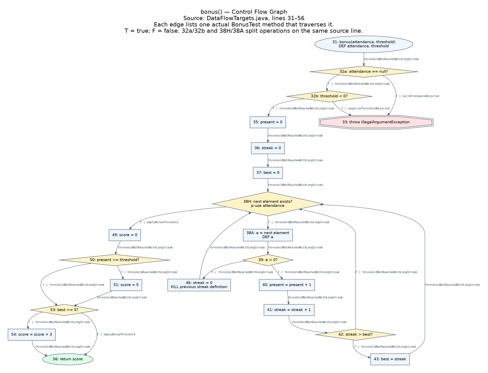

# Lab 10 — Өгөгдлийн урсгалын тест
Хичээл: F.CSA313 — Программ хангамжийн чанарын баталгаа ба тест
Гүйцэтгэсэн: Э.Цэгмид
Оюутны код: B232270107

### java -version

```text
tsegmid@debian:~/Documents/gobi bagsh/lab10-dataflow/f.csa313-lab10$ java -version
openjdk version "21.0.13" 2026-10-20
OpenJDK Runtime Environment (build 21.0.13+9-1-deb13u2-Debian)
OpenJDK 64-Bit Server VM (build 21.0.13+9-1-deb13u2-Debian, mixed mode, sharing)
```

### mvn -version

```text
tsegmid@debian:~/Documents/gobi bagsh/lab10-dataflow/f.csa313-lab10$ mvn -version
Apache Maven 3.9.9
Maven home: /usr/share/maven
Java version: 21.0.13, vendor: Debian, runtime: /usr/lib/jvm/java-21-openjdk-amd64
Default locale: en_US, platform encoding: UTF-8
OS name: "linux", version: "6.12.113+deb13-amd64", arch: "amd64", family: "unix"
```

## A. gcd — DU анализ

Definition (def) нь хувьсагч утга авах цэг.
c-use нь тооцоолол, оноолт, return-д ашиглах цэг.
p-use нь нөхцөл шалгахад ашиглах цэг.
Def-clear замд тухайн хувьсагч дахин утга авахгүй.

### Def/use жагсаалт

| Мөр | Def | c-use | p-use |
|---|---|---|---|
| 13 | x, y | — | — |
| 15 | — | — | y |
| 16 | tmp | x, y | — |
| 17 | x | y | — |
| 18 | y | tmp | — |
| 20 | — | x | — |

### Тестүүд

- G1 — `zeroSecondArgument`: gcd(7, 0) = 7. Давталтгүй зам.
- G2 — `twoIterations`: gcd(12, 8) = 4. Хоёр давталттай зам.

G2-ийн эхэнд (x, y) = (12, 8), эхний давталтын дараа
(8, 4), хоёр дахь давталтын дараа (4, 0) болно.

### DU хүснэгт

T — нөхцөл үнэн, F — нөхцөл худал.
Мөрийн дугаарууд DataFlowTargets.java файлтай таарна.

| Хувьсагч | Def мөр | Use мөр | Төрөл | Def-clear зам | Тестийн ID | Хамрагдсан |
|---|---:|---:|---|---|---|---|
| x | 13 | 16 | c-use | 13 → 15T → 16 | G2 | Тийм |
| x | 13 | 20 | c-use | 13 → 15F → 20 | G1 | Тийм |
| x | 17 | 16 | c-use | 17 → 18 → 15T → 16 | G2 | Тийм |
| x | 17 | 20 | c-use | 17 → 18 → 15F → 20 | G2 | Тийм |
| y | 13 | 15 | p-use (T) | 13 → 15T | G2 | Тийм |
| y | 13 | 15 | p-use (F) | 13 → 15F | G1 | Тийм |
| y | 13 | 16 | c-use | 13 → 15T → 16 | G2 | Тийм |
| y | 13 | 17 | c-use | 13 → 15T → 16 → 17 | G2 | Тийм |
| y | 18 | 15 | p-use (T) | 18 → 15T | G2 | Тийм |
| y | 18 | 15 | p-use (F) | 18 → 15F | G2 | Тийм |
| y | 18 | 16 | c-use | 18 → 15T → 16 | G2 | Тийм |
| y | 18 | 17 | c-use | 18 → 15T → 16 → 17 | G2 | Тийм |
| tmp | 16 | 18 | c-use | 16 → 17 → 18 | G2 | Тийм |

Хувьсагч–def мөр–use мөрөөр тоолбол 11 DU хос.
p-use-ийн T/F салааг тусад нь бичсэнээр хүснэгт 13 мөртэй.

G1 нь x-ийн 13-р мөрийн def-ийг 20-р мөрийн return-д хүргэдэг.
Давталтад орвол 17-р мөр x-ийн өмнөх def-ийг kill хийнэ.

### A шатны шалгалт

mvn verify: Tests run: 2, Failures: 0, Errors: 0, Skipped: 0.
BUILD SUCCESS; JaCoCo тайлан үүссэн.

#

## B. bonus — Өгөгдлийн урсгалын анализ

### Def/use жагсаалт

| Мөр | Def | c-use | p-use |
|---|---|---|---|
| 31 | attendance, threshold | — | — |
| 32 | — | — | attendance, threshold |
| 35 | present | — | — |
| 36 | streak | — | — |
| 37 | best | — | — |
| 38 | a (элемент бүрд) | — | attendance (дараагийн элемент байгаа эсэх) |
| 39 | — | — | a |
| 40 | present | present | — |
| 41 | streak | streak | — |
| 42 | — | — | streak, best |
| 43 | best | streak | — |
| 46 | streak | — | — |
| 49 | score | — | — |
| 50 | — | — | present, threshold |
| 51 | score | — | — |
| 53 | — | — | best |
| 54 | score | score | — |
| 56 | — | score | — |

32-р мөрийн || нь short-circuit: attendance null бол
threshold < 0 нөхцөлийг шалгахгүй.

40, 41, 54-р мөрөнд баруун талын хуучин утгыг эхлээд ашиглаж,
дараа нь зүүн талын хувьсагчид шинэ утга онооно.

### All-defs — хамгийн цөөн тест

| ID | Метод | Attendance | Threshold | Expected |
|---|---|---|---:|---:|
| B1 | thresholdNotReachedWithLongStreak | {1,1,0,1,1,1,1,1} | 8 | 3 |
| B2 | thresholdReachedWithLongStreak | {1,1,0,1,1,1,1,1} | 7 | 8 |

Хоёр тохиолдолд present = 7, best = 5.
B1-д ирцийн босго хүрэхгүй тул зөвхөн цувааны 3 оноо авна.
B2-д ирцийн 5 ба цувааны 3 оноо нийлж 8 болно.

Хамгийн багадаа хоёр bonus дуудлага шаардлагатай.
50-р мөр үнэн бол score-ийн 49-р мөрийн def-ийг 51-р мөр
use-д хүрэхээс өмнө kill хийнэ. Харин нөхцөл худал бол
51-р мөрийн def үүсэхгүй. Нэг дуудлагаар эдгээр хоёр def-ийг
хоёуланг use-д хүргэх боломжгүй.

B1 нь score:49→54, B2 нь score:51→54 хосыг хамарна.
Хоёулаа score:54→56 хосыг хамарна.

Бусад def-үүдийн use-д хүрэх жишээ:
attendance:31→32, threshold:31→32, present:35→40,
present:40→50, streak:36→41, streak:41→42,
streak:46→41, best:37→42, best:43→53, a:38→39.
Ингэснээр хоёр тест bonus-ийн бүх def-ийг дор хаяж нэг use-д хүргэнэ.

### All-defs шатны бодит үр дүн

Нотолгоо:
- results/mvn-verify-alldefs.txt
- results/jacoco-alldefs.csv

Нийт 4 тест: GcdTest 2, BonusTest 2.
Failures: 0, Errors: 0, Skipped: 0. BUILD SUCCESS.

| Үзүүлэлт | Covered | Missed | Хамралт |
|---|---:|---:|---:|
| Branch | 13 | 3 | 81.25% |
| Line | 22 | 2 | 91.67% |

Эдгээр хэмжилт нь gcd болон bonus-ийг агуулсан
DataFlowTargets классын нийт хэмжилт.

All-defs хангагдсан ч branch 100% болоогүй.
Энэ шатанд null оролт, сөрөг threshold, best < 5 салаа
хамрагдаагүй. Хамрагдаагүй хоёр мөр нь 7-р мөрийн далд
constructor болон 33-р мөрийн exception шидэх үйлдэл.

### Bonus-ийн бүрэн DU хүснэгт

Тэмдэглэгээ:
- 32a: attendance == null.
- 32b: threshold < 0. Зөвхөн 32a худал үед шалгана.
- 38H: дараагийн элемент байгаа эсэх; attendance-ийн p-use.
- 38A: дараагийн элементийг a-д оноох; a-ийн def.
- T/F: нөхцөлийн үнэн/худал салаа.
- V: 31 → 32aF → 32bF → 35 → 36 → 37 гэсэн зам.

B1–B8 нь BonusTest-ийн @DisplayName дахь ID-ууд.
Методын нэрүүд:

| ID | Метод |
|---|---|
| B1 | thresholdNotReachedWithLongStreak |
| B2 | thresholdReachedWithLongStreak |
| B3 | emptyBelowThreshold |
| B4 | emptyAtZeroThreshold |
| B5 | singlePresentBelowThreshold |
| B6 | allAbsentAtZeroThreshold |
| B7 | nullAttendanceRejected |
| B8 | negativeThresholdRejected |

Хүснэгтэд def-clear замын нэг жишээ болон түүнийг гүйцэтгэх
тестийг бичсэн. Бүх боломжит урт замыг жагсаагаагүй.

| Хувьсагч | Def мөр | Use мөр | Төрөл | Def-clear зам | Тестийн ID | Хамрагдсан |
|---|---:|---|---|---|---|---|
| attendance | 31 | 32a | p-use T | 31 → 32aT | B7 | Тийм |
| attendance | 31 | 32a | p-use F | 31 → 32aF | B1 | Тийм |
| attendance | 31 | 38H | p-use T | V → 38HT | B1 | Тийм |
| attendance | 31 | 38H | p-use F | V → 38HF | B3 | Тийм |
| threshold | 31 | 32b | p-use T | 31 → 32aF → 32bT | B8 | Тийм |
| threshold | 31 | 32b | p-use F | 31 → 32aF → 32bF | B1 | Тийм |
| threshold | 31 | 50 | p-use T | V → 38HF → 49 → 50T | B4 | Тийм |
| threshold | 31 | 50 | p-use F | V → 38HF → 49 → 50F | B3 | Тийм |
| present | 35 | 40 | c-use | 35 → 36 → 37 → 38HT → 38A → 39T → 40 | B1 | Тийм |
| present | 35 | 50 | p-use T | 35 → 36 → 37 → 38HF → 49 → 50T | B4 | Тийм |
| present | 35 | 50 | p-use F | 35 → 36 → 37 → 38HF → 49 → 50F | B3 | Тийм |
| present | 40 | 40 | c-use | 40 → 41 → 42T → 43 → 38HT → 38A → 39T → 40 | B1 | Тийм |
| present | 40 | 50 | p-use T | 40 → 41 → 42T → 43 → 38HF → 49 → 50T | B2 | Тийм |
| present | 40 | 50 | p-use F | 40 → 41 → 42T → 43 → 38HF → 49 → 50F | B1 | Тийм |
| streak | 36 | 41 | c-use | 36 → 37 → 38HT → 38A → 39T → 40 → 41 | B1 | Тийм |
| streak | 41 | 41 | c-use | 41 → 42T → 43 → 38HT → 38A → 39T → 40 → 41 | B1 | Тийм |
| streak | 41 | 42 | p-use T | 41 → 42T | B1 | Тийм |
| streak | 41 | 42 | p-use F | 41 → 42F | B1 | Тийм |
| streak | 41 | 43 | c-use | 41 → 42T → 43 | B1 | Тийм |
| streak | 46 | 41 | c-use | 46 → 38HT → 38A → 39T → 40 → 41 | B1 | Тийм |
| best | 37 | 42 | p-use T | 37 → 38HT → 38A → 39T → 40 → 41 → 42T | B1 | Тийм |
| best | 37 | 53 | p-use F | 37 → 38HF → 49 → 50F → 53F | B3 | Тийм |
| best | 43 | 42 | p-use T | 43 → 38HT → 38A → 39T → 40 → 41 → 42T | B1 | Тийм |
| best | 43 | 42 | p-use F | 43 → 38HT → 38A → 39F → 46 → 38HT → 38A → 39T → 40 → 41 → 42F | B1 | Тийм |
| best | 43 | 53 | p-use T | 43 → 38HF → 49 → 50T → 53T | B2 | Тийм |
| best | 43 | 53 | p-use F | 43 → 38HF → 49 → 50F → 53F | B5 | Тийм |
| a | 38A | 39 | p-use T | 38A → 39T | B1 | Тийм |
| a | 38A | 39 | p-use F | 38A → 39F | B1 | Тийм |
| score | 49 | 54 | c-use | 49 → 50F → 53T → 54 | B1 | Тийм |
| score | 49 | 56 | c-use | 49 → 50F → 53F → 56 | B3 | Тийм |
| score | 51 | 54 | c-use | 51 → 53T → 54 | B2 | Тийм |
| score | 51 | 56 | c-use | 51 → 53F → 56 | B4 | Тийм |
| score | 54 | 56 | c-use | 54 → 56 | B1 | Тийм |

Хүснэгт нь T/F салааг ялгасан 33 боломжит шаардлагатай.
Салаануудыг нэгтгэж хувьсагч–def мөр–use мөрөөр тоолбол
23 боломжит DU хос болно.

### Kill болон def-clear замгүй хослолууд

46-р мөрийн streak = 0 нь түүнд хүрч ирсэн streak-ийн өмнөх
def-ийг kill хийнэ. Энэ нь эхний тасалсан өдөр бол 36,
ирсэн өдрийн дараа бол 41, дараалсан тасалсан өдөр бол
өмнөх давталтын 46-р мөрийн def байж болно.

streak:36→42, streak:36→43, streak:46→42, streak:46→43
хослолууд def-clear замгүй. 42 эсвэл 43-р мөрөнд хүрэхийн
өмнө 41-р мөр заавал streak-д шинэ утга онооно.
Иймээс эдгээрийг DU хүснэгтийн боломжит хосуудад тооцоогүй.

streak:41→41 нь дараалсан ирсэн өдрүүдэд боломжтой.
Харин зам дунд 46-р мөрөөр орвол өмнөх 41-ийн def kill
болдог тул тэр тодорхой зам def-clear биш.

score:49→56 зам 51 эсвэл 54-р мөрөөр дайрвал def-clear биш.
Гэхдээ 50F → 53F замаар боломжтой учраас DU хос мөн.
score:51→56 нь 53F үед def-clear; 54-р мөрөөр дайрвал kill болно.

### Биелэшгүй p-use салаанууд

- best:37→42F биелэшгүй. 37-р мөрийн best = 0 хэвээр
  байхад 42-р мөрөнд анх хүрэхэд streak = 1 тул 1 > 0 үнэн.
- best:37→53T биелэшгүй. 37-р мөрийн def kill болоогүй
  бол best = 0 хэвээр тул best >= 5 худал.

### All-DU-pairs шатны бодит үр дүн

Нотолгоо:
- results/mvn-verify-allpairs.txt
- results/jacoco-allpairs.csv

Нийт 10 тест: GcdTest 2, BonusTest 8.
Failures: 0, Errors: 0, Skipped: 0. BUILD SUCCESS.

| Үзүүлэлт | Covered | Missed | Хамралт |
|---|---:|---:|---:|
| Branch | 16 | 0 | 100% |
| Line | 23 | 1 | 95.83% |

Хамрагдаагүй мөр нь 7-р мөрийн далд constructor.
Түүнийг хамруулахын тулд нэмэлт объект үүсгэх тест бичээгүй.

### Branch 100% ба DU хамралтын ялгаа

Замуудыг шинжлэхэд B1, B2, B3, B7, B8 гэсэн дэд багц
бүх branch-ийг хамарна. Гэхдээ best:43→53F хосыг хамрахгүй:
B1/B2-д шинэчлэгдсэн best нь 5, B3-д best-ийн def нь 37,
B7/B8 нь exception шидэж гарна. B5 нь best-ийг 43-р мөрөнд
1 болгосны дараа 53F салаанд хүргэж энэ хосыг хамарна.
Иймээс branch бүрээр орсон гэдэг нь def бүрийн утга
холбогдох use бүрд хүрсэн гэсэн баталгаа биш.

### Bonus CFG



Зангилаанууд эх кодын мөрийн дугаартай.
Ирмэг бүрд түүнийг дайрдаг тестийн бодит методын нэр бичсэн.

## C. Fault seeding

Мутаци бүрийг түр оруулж, туршилтын дараа git restore ашиглан буцаасан.

| Туршилт | Tests run | Failures | Үр дүн | Нотолгоо |
|---|---:|---:|---|---|
| M1 | 10 | 2 | Илрүүлсэн | results/mvn-test-M1.txt |
| M2, B9-гүй | 10 | 0 | Амьд үлдсэн | results/mvn-test-M2.txt |
| M2, B9-тэй | 11 | 1 | Илрүүлсэн | results/mvn-test-M2-kill.txt |
| M3 | 11 | 0 | Амьд үлдсэн | results/mvn-test-M3.txt |

Бүх туршилтад Errors: 0, Skipped: 0.

### M1 — Missing update

streak нэмэх мөрийг устгахад цувааны 3 оноо олгогдохгүй болсон.
Логоос авсан унасан тестүүд:

- `BonusTest.thresholdNotReachedWithLongStreak:16 expected: <3> but was: <0>`
- `BonusTest.thresholdReachedWithLongStreak:24 expected: <8> but was: <5>`

### M2 — Wrong variable

Нөхцөлтэй best = streak шинэчлэлтийг best = present болгосон.
B1/B2-д зөв best = 5, мутацийн best = 7.
Хоёулаа best >= 5 тул буцаах оноо ижил.
Эхний ирсэн өдрүүдэд present ба streak тэнцүү боловч
тасалсан өдрийн дараа ялгаатай болдог.
DU хамралт бүрэн ч буруу утгын нөлөө гаралтад илрэхгүй байж болно.

B9 — interruptedStreakMustNotUseTotalAttendance:
attendance = {1,1,0,1,1,1,1}, threshold = 6.
Нийт ирц 6, хамгийн урт цуваа 4.
Зөв хариу 5 боловч M2 нь 8 буцаасан.

Логоос авсан мөр:
`BonusTest.interruptedStreakMustNotUseTotalAttendance:69 expected: <5> but was: <8>`

M2-ийн эхний логт B9-ийг хасаж 10 тест ажиллуулсан.
M2-kill логт B9-ийг оруулж 11 тест ажиллуулсан.

### M3 — Dead definition

Давталтын дараа `int total = present + best;` мөр нэмсэн.
total утга авсан ч түүнийг ашиглах use байхгүй.
Буцаах score өөрчлөгдөхгүй тул бүх 11 тест амжилттай.
javac ашиглагдаагүй local хувьсагчийн анхааруулга гаргаагүй.

VS Code-ийн Java static analysis дараах анхааруулгыг гаргасан:

> The value of the local variable total is not used
> Java(536870973)

Dead definition-ийг IDE inspection болон static analysis-аар илрүүлнэ.

### Эцсийн шалгалт

Нотолгоо: results/mvn-verify-final.txt, results/jacoco-final.csv.
Нийт 11 тест: GcdTest 2, BonusTest 9.
Failures: 0, Errors: 0, Skipped: 0. BUILD SUCCESS.

| Шат | Branch covered/total | Line covered/total |
|---|---|---|
| All-defs | 13/16 | 22/24 |
| All-DU-pairs, B9-гүй | 16/16 | 23/24 |
| Эцсийн, B9-тэй | 16/16 | 23/24 |

Эцсийн BRANCH_MISSED = 0, LINE_MISSED = 1.
Хамрагдаагүй мөр нь 7-р мөрийн далд constructor.
`git diff b4f0b5d -- src/main` гаралт хоосон:
үндсэн код Starter хувилбартай ижил.
### AI туслахын хэрэглээ

Лабораторийн ажлын явцад ChatGPT-ээс DU анализ, Git/Maven командууд болон тестийн зохион байгуулалтын талаар зөвлөгөө авч, тест, тайлангийн эх болон CFG бэлтгэхэд тусламж авсан.
## Дүгнэлт

DU анализ нь хувьсагчийн утга тодорхойлогдсон цэгээс ашиглагдах цэг хүртэл дахин тодорхойлогдолгүй хүрч байгаа эсэхийг шалгадаг.
Branch хамралт бүх салааг хамарсан ч best:43→53F зэрэг DU хосыг орхиж болохыг тестүүдийн дэд багцаар харуулсан.
DU анализ хийхэд def/use цэгүүд, kill болон биелэшгүй замуудыг гараар ялгах нэмэлт хөдөлмөр шаардсан.
M2 мутаци анхны тестүүдийг давсан тул хамралтаас гадна буруу утгыг гаралтаар ялгах оролт сонгох шаардлагатайг ойлгосон.
M3 мутацийг тестүүд илрүүлээгүй боловч IDE-ийн static analysis ашиглагдаагүй хувьсагчийн анхааруулга өгсөн.
Эцэст нь үндсэн кодыг сэргээж, бүх 11 тест амжилттай, branch хамралт 16/16 болсныг баталгаажуулсан.CFG-ийн зангилаа, салаа болон ирмэг бүрийн тестийн нэрийг тааруулж зураг бэлтгэх алхам хамгийн их цаг авсан.