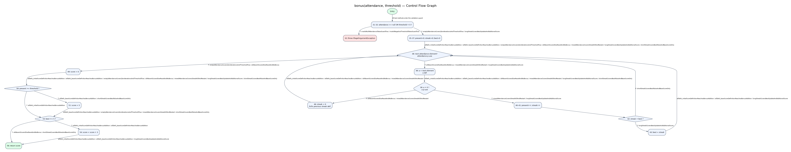

# Lab 10 — Dataflow Testing: Definition–Use Pairs

**Student:** Tsegmid Enkhbold  
**Student ID:** To be added before submission (the ID was not present in the materials available for this rebuild).

## Environment

The build environment is recorded verbatim in [results/environment.txt](results/environment.txt). The workflow uses Eclipse Temurin JDK 17 and Maven on GitHub Actions. The complete local versions must be recorded here if the project is also verified on the student's own machine.

```text
See results/environment.txt for the complete java -version and mvn -version output.
```

## Part A — gcd(x, y)

The source file is kept unchanged. The line numbers below refer to `DataFlowTargets.java`, not the shortened lecture slide numbering.

### Definition/use inventory

| Variable | Definition | Use | Kind | Def-clear path / condition | Test |
|---|---:|---:|---|---|---|
| x | 13 | 15 | p-use indirectly? | The loop condition reads y, not x; therefore this is **not** an x-use. | — |
| x | 13 | 16 | c-use | First loop iteration, when y != 0 | `gcd_12_8_coversLoopDuPairs` |
| x | 13 | 20 | c-use | Initial y == 0; no loop assignment kills x | `gcd_7_0_covers_initialXToReturnAndFalseWhile` |
| x | 17 | 16 | c-use | At least one further loop iteration after x = y | `gcd_12_8_coversLoopDuPairs` |
| x | 17 | 20 | c-use | Loop terminates after the assignment x = y | `gcd_12_8_coversLoopDuPairs` |
| y | 13 | 15 | p-use (T/F) | Initial loop test; T for nonzero y, F for y = 0 | Both GCD tests |
| y | 13 | 16 | c-use | First iteration with y != 0 | `gcd_12_8_coversLoopDuPairs` |
| y | 13 | 17 | c-use | First iteration; right-hand side of x = y | `gcd_12_8_coversLoopDuPairs` |
| y | 18 | 15 | p-use (T/F) | Next loop test after y = tmp | `gcd_12_8_coversLoopDuPairs` |
| y | 18 | 16 | c-use | A further iteration after y is redefined | `gcd_12_8_coversLoopDuPairs` |
| y | 18 | 17 | c-use | A further iteration; x = y reads the current y | `gcd_12_8_coversLoopDuPairs` |
| tmp | 16 | 18 | c-use | The assignment y = tmp in the same iteration | `gcd_12_8_coversLoopDuPairs` |

The `x:13 → line 20` pair is uniquely covered by `gcd(7, 0)`: the loop is skipped, so the initial x definition reaches the return without being redefined. `gcd(12, 8)` executes exactly **two** loop iterations: (12, 8) → (8, 4) → (4, 0). The repeated iteration is needed for the loop-carried definitions and uses of x and y. The two tests together exercise the listed feasible DU pairs.

## Part B — bonus(attendance, threshold)

### B1. Control-flow graph

The CFG is intended to show the validation guard, the enhanced-for iteration (the loop test is an attendance p-use and assigning the next element defines `a`), both inner branches, the streak reset, and the score decisions. Edge labels identify the test method(s) exercising each branch.



### B2. Definition/use inventory

| Source line | Definition(s) | Use(s) |
|---:|---|---|
| 32 | — | `attendance` p-use (null check), `threshold` p-use (negative check; short-circuit) |
| 34 | `present = 0` | — |
| 35 | `streak = 0` | — |
| 36 | `best = 0` | — |
| 38 | `a` (each iteration) | `attendance` p-use for next-element / loop termination |
| 39 | — | `a` p-use (`a > 0`) |
| 40 | `present = present + 1` | `present` c-use |
| 41 | `streak = streak + 1` | `streak` c-use |
| 42 | — | `streak` and `best` p-use (`streak > best`) |
| 43 | `best = streak` | `streak` c-use |
| 46 | `streak = 0` | —; this definition kills the prior streak definition |
| 48 | `score = 0` | — |
| 49 | — | `present` and `threshold` p-use (`present >= threshold`) |
| 50 | `score = 5` | — |
| 52 | — | `best` p-use (`best >= 5`) |
| 53 | `score = score + 3` | `score` c-use |
| 55 | — | `score` c-use (return) |

### B3. Def-clear DU pairs

| Variable | Def line | Use line | Use type | Def-clear condition / note | Test ID |
|---|---:|---:|---|---|---|
| attendance | parameter | 32 | p | Guard reads the parameter | invalid-null / invalid-negative |
| attendance | parameter | 38 | p | Iteration checks for another element | mixed / long / absent |
| threshold | parameter | 32 | p | Negative-threshold check is evaluated when attendance is non-null | invalid-negative |
| threshold | parameter | 49 | p | Valid input reaches the score threshold decision | empty / short / all-defs |
| a | 38 | 39 | p | Each fetched element is tested before next assignment | mixed / absent / long |
| present | 34 | 40 | c | First present day increments initial count | mixed / long |
| present | 34 | 49 | p | No present day has redefined present | empty / all-absent |
| present | 40 | 40 | c | A later present day increments the previous count | mixed / long |
| present | 40 | 49 | p | Last count definition reaches threshold decision | mixed / long |
| streak | 35 | 41 | c | First element is present | long |
| streak | 41 | 41 | c | Consecutive present days carry the previous streak | long |
| streak | 41 | 42 | p | Updated streak is compared with best | long / short |
| streak | 46 | 41 | c | A present day follows an absent day; reset value is incremented | mixed |
| best | 36 | 42 | p | First present day compares streak with initial best | long / short |
| best | 36 | 52 | p | No positive attendance ever redefines best | empty / all-absent |
| best | 43 | 42 | p | A later positive day compares with the previous best | long / mixed |
| best | 43 | 52 | p | Final best reaches the bonus decision without another best update | long / short |
| score | 48 | 53 | c | Threshold is false and the streak bonus branch is true | all-defs initial-score |
| score | 48 | 55 | c | Threshold and streak bonus are both false | all-absent |
| score | 50 | 53 | c | Base score definition reaches the +3 calculation | all-defs base-score |
| score | 50 | 55 | c | Base score reaches return without streak bonus | short |
| score | 53 | 55 | c | Updated score reaches return | all-defs initial-score / all-defs base-score |

**Kill at line 46:** the assignment `streak = 0` kills any earlier definition of `streak` (initialization at line 35 or increment at line 41) along a path that reaches this assignment. Consequently, an earlier streak definition cannot be paired with a later line-42 comparison if the path crosses line 46 first. The reset definition at line 46 can reach the line-41 increment when a later attendance element is positive.

The foreach p-use has a true outcome when an element exists and a false outcome when iteration terminates. The true outcome is exercised by every non-empty attendance test; the false outcome is exercised after the final element and by the empty-array case. The `a > 0` predicate's true and false outcomes are both feasible and are exercised by positive and absent attendance values. The `streak > best` predicate's true and false outcomes are both feasible (first/longer streak versus a shorter streak after an earlier best). The threshold and final best predicates likewise have feasible true and false outcomes in the test set.

### B4. Two-stage test design

**All-defs minimum: two tests.** Two are necessary because the two definitions of `score` at lines 48 and 50 cannot both reach the line-53 use in one execution: if the threshold branch is true, line 50 redefines score and kills line 48 before the +3 calculation. The first all-defs test makes the threshold condition false and the streak condition true, so line 48 reaches line 53. The second makes the threshold condition true and the streak condition true, so line 50 reaches line 53. The tests are retained as the first stage in the commit history.

**All-DU-pairs stage.** Additional tests cover null and negative validation, empty input, all-absent input, mixed attendance with a streak reset, a long streak, and a short streak. The tests have Latin-only method names and display names so their console output remains readable on Windows.

### B5. JaCoCo interpretation

The all-defs and final JaCoCo CSV files are generated by the workflow and stored under `results/`. The exact Branch and Line missed/covered counts must be read from those CSV files; no coverage percentage is inferred from the manually prepared DU table. The required final result is `BRANCH_MISSED = 0` (16/16 branches) and `LINE_MISSED = 1`, where the single missed line is the implicit Java constructor on source line 7. No test should instantiate `DataFlowTargets` just to cover that compiler-generated constructor.

Branch coverage is not DU coverage. Branch coverage only shows that both outcomes of each decision were executed; it does not prove that each variable definition reached each relevant use along a def-clear path. For example, a branch can be taken while a particular earlier definition has already been killed by a redefinition, leaving a DU pair uncovered even though the branch itself is covered.

## Part C — Fault seeding

The CI workflow temporarily applies each mutation to the original `DataFlowTargets.java`, runs `mvn test`, records the output, and restores the original source before the next mutation. The final verification step checks that the production source has no diff.

| Mutation | Fault | Expected observation | Evidence |
|---|---|---|---|
| M1 | Remove `streak = streak + 1` | Long-streak expected result fails because the best streak is no longer accumulated | `results/mvn-test-M1.txt` |
| M2 | Replace `best = streak` with `best = present` | Regression test with five total present days but maximum streak of three fails; the mutant incorrectly awards the streak bonus | `results/mvn-test-M2.txt` |
| M3 | Add unused `int total = present + best;` | Tests still pass because the new definition is dead and does not affect observable output; static analysis / IDE inspection should flag the unused local variable | `results/mvn-test-M3.txt` |

The M2 regression case is `duM2KillBestMustTrackLongestConsecutiveStreak`: attendance `{1, 1, 0, 1, 1, 1}` has five present days but the longest consecutive streak is only three. With threshold six, the correct result is zero; the mutated assignment incorrectly makes `best` equal to the total present count and returns three. M3 is a dead definition, so runtime tests cannot observe it; a static-analysis inspection is the appropriate tool.

## Conclusion

Definition-use analysis makes the relationship between a variable's assignments and later reads explicit. It finds data-flow faults that branch coverage alone can miss because a branch can execute after a definition has been overwritten. The GCD example shows why loop-carried definitions and the zero-iteration path need separate tests. The bonus function adds kills and redefinitions, especially the streak reset, which make def-clear reasoning more demanding. The all-defs minimum is constrained by the two distinct score definitions and their kill relationship. Mutation testing checks whether the tests detect missing updates and incorrect variable assignments, while the dead-definition mutation demonstrates the value of static analysis. The most time-consuming part is enumerating def-clear paths and matching each pair to an executable test.

## AI assistance disclosure

ChatGPT was used to help enumerate candidate DU pairs, draft JUnit tests, construct the CFG, and prepare the README. The code, tests, and analysis are intended to be checked against the actual Maven and JaCoCo outputs before submission; the captured result files are the source of truth for execution and coverage claims.
