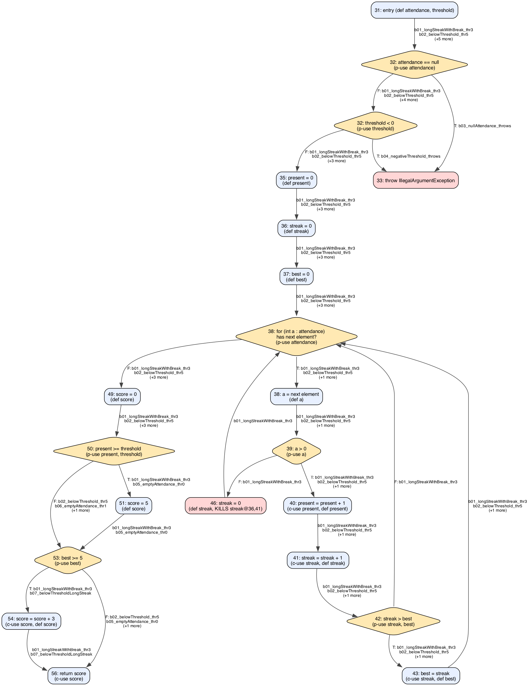

# Лаборатори №10 — Өгөгдлийн урсгалын тест, Definition-Use хосууд

Нэр: Э.Цэгмид
Оюутны код: B232270107

Орчны гаралт:

```text
openjdk version "27.0.1.0.3" 2026-10-24
OpenJDK Runtime Environment Homebrew (build 27.0.1.0.3)
OpenJDK 64-Bit Server VM Homebrew (build 27.0.1.0.3, mixed mode, sharing)

Apache Maven 3.9.9 (8e8579a9e76f7d015ee5ec7bfcdc97d260186937)
Maven home: /opt/homebrew/Cellar/maven/3.9.9/libexec
Java version: 27.0.1.0.3, vendor: Homebrew, runtime: /opt/homebrew/Cellar/openjdk/27.0.1.0.3/libexec/openjdk.jdk/Contents/Home
Default locale: en_MN, platform encoding: UTF-8
OS name: "mac os x", version: "26.6.2", arch: "aarch64", family: "mac"
```

Бүх мөрийн дугаар нь `DataFlowTargets.java` файлын мөр (лекцийн 1,3,4,5,6,8 → файлын 13,15,16,17,18,20).

## A — gcd(): бүрэн DU хүснэгт

`gcd(int x, int y)`-ийн зангилаа: 13 (параметрийн def: x, y), 15 (`while (y != 0)`), 16 (`tmp = x % y`), 17 (`x = y`), 18 (`y = tmp`), 20 (`return x`). Ирмэг: 13→15, 15→16 (T), 16→17, 17→18, 18→15, 15→20 (F). 14-р мөрийн `int tmp;` нь зөвхөн зарлалт, def биш тул `tmp`-ийн цорын ганц def нь 16.

Def/use: 13 — def x, y · 15 — p-use y · 16 — c-use x, y; def tmp · 17 — c-use y; def x · 18 — c-use tmp; def y · 20 — c-use x.

p-use-ийг T/F салаагаар нь тусад нь тоолсон тул нийт **13 DU хос** (x: 4, y: 8, tmp: 1).

| # | Хувьсагч | Def мөр | Use мөр | Төрөл | Def-clear зам | Тестийн ID | Хамрагдсан |
|---|----------|--------:|--------:|-------|---------------|------------|:----------:|
| 1 | x | 13 | 16 | c-use | 13→15→16 | G2, G3 | ✔ |
| 2 | x | 13 | 20 | c-use | 13→15→20 | G1 | ✔ |
| 3 | x | 17 | 16 | c-use | 17→18→15→16 | G2 | ✔ |
| 4 | x | 17 | 20 | c-use | 17→18→15→20 | G2, G3 | ✔ |
| 5 | y | 13 | 15 (T) | p-use | 13→15 ⇒ 16 | G2, G3 | ✔ |
| 6 | y | 13 | 15 (F) | p-use | 13→15 ⇒ 20 | G1 | ✔ |
| 7 | y | 13 | 16 | c-use | 13→15→16 | G2, G3 | ✔ |
| 8 | y | 13 | 17 | c-use | 13→15→16→17 | G2, G3 | ✔ |
| 9 | y | 18 | 15 (T) | p-use | 18→15 ⇒ 16 | G2 | ✔ |
| 10 | y | 18 | 15 (F) | p-use | 18→15 ⇒ 20 | G2, G3 | ✔ |
| 11 | y | 18 | 16 | c-use | 18→15→16 | G2 | ✔ |
| 12 | y | 18 | 17 | c-use | 18→15→16→17 | G2 | ✔ |
| 13 | tmp | 16 | 18 | c-use | 16→17→18 | G2, G3 | ✔ |

Тестүүд (`GcdTest.java`, метод бүрийн `@DisplayName`-д хамарсан хосууд нь `хувьсагч:def->use` хэлбэрээр бичигдсэн):

| ID | Метод | Оролт → гаралт | Давталт |
|----|-------|----------------|--------:|
| G1 | `g1_zeroIterations_gcd7_0` | gcd(7,0) = 7 | 0 |
| G2 | `g2_twoIterations_gcd12_8` | gcd(12,8) = 4 | 2 |
| G3 | `g3_oneIteration_gcd0_5` | gcd(0,5) = 5 | 1 |

- `gcd(7,0)` давталтад огт орохгүй тул **ганцаараа** зөвхөн хос 2 (`x:13→20`) ба хос 6 (`y:13→15F`)-ийг хамардаг. Бусад 11 хос давталтын биеийг ажиллуулахыг шаарддаг.
- `gcd(12,8)` нь 2 давталт хийдэг (y: 8 → 4 → 0). Давталтын 1-р алхмын def (`x`@17, `y`@18)-ийг 2-р алхам ашигладаг тул хос 3, 9, 11, 12 (`x:17→16`, `y:18→15T`, `y:18→16`, `y:18→17`) зөвхөн ≥2 давталттай тестээр хамрагдана; эдгээрийг G2 ганцаараа хамарна.
- G1 + G2 нь 13 хосыг бүгдийг хамарна (all-DU-pairs). G3 нь спецификацийн жишээ бөгөөд шинэ хос нэмэхгүй.

## B — bonus(): бүрэн анализ

### B1 — CFG



`cfg-bonus.png` (Graphviz-ээр зурсан, эх нь `cfg-bonus.dot`). Зангилаа бүр файлын мөрийн дугаартай (`42: streak > best`), шийдвэрийн зангилаа нь ромбо. 32-р мөрийн `||` нөхцөлийг хоёр зангилаа (`32: attendance == null`, `32: threshold < 0`) болгон, for-each (мөр 38)-ийг "дараагийн элемент байгаа эсэх" нөхцөл ба "`a`-д дараагийн элементийг онооно" (def a) гэсэн хоёр зангилаа болгон тусгаарласан. Ирмэг бүрийн хажууд түүнийг дайрдаг тестийн бодит метод нэр байна (дөрвөөс дээш бол эхний хоёр ба `+N more`); бүрэн жагсаалтыг доорх хүснэгтээс хар. Бүх 26 ирмэг хамрагдсан.

| Ирмэг | Салаа | Дайрдаг тестүүд |
|-------|:-----:|-----------------|
| 31 → 32a |  | `b01_longStreakWithBreak_thr3`, `b02_belowThreshold_thr5`, `b03_nullAttendance_throws`, `b04_negativeThreshold_throws`, `b05_emptyAttendance_thr0`, `b06_emptyAttendance_thr1`, `b07_belowThresholdLongStreak` |
| 32a → 33 | T | `b03_nullAttendance_throws` |
| 32a → 32b | F | `b01_longStreakWithBreak_thr3`, `b02_belowThreshold_thr5`, `b04_negativeThreshold_throws`, `b05_emptyAttendance_thr0`, `b06_emptyAttendance_thr1`, `b07_belowThresholdLongStreak` |
| 32b → 33 | T | `b04_negativeThreshold_throws` |
| 32b → 35 | F | `b01_longStreakWithBreak_thr3`, `b02_belowThreshold_thr5`, `b05_emptyAttendance_thr0`, `b06_emptyAttendance_thr1`, `b07_belowThresholdLongStreak` |
| 35 → 36 |  | `b01_longStreakWithBreak_thr3`, `b02_belowThreshold_thr5`, `b05_emptyAttendance_thr0`, `b06_emptyAttendance_thr1`, `b07_belowThresholdLongStreak` |
| 36 → 37 |  | `b01_longStreakWithBreak_thr3`, `b02_belowThreshold_thr5`, `b05_emptyAttendance_thr0`, `b06_emptyAttendance_thr1`, `b07_belowThresholdLongStreak` |
| 37 → 38 |  | `b01_longStreakWithBreak_thr3`, `b02_belowThreshold_thr5`, `b05_emptyAttendance_thr0`, `b06_emptyAttendance_thr1`, `b07_belowThresholdLongStreak` |
| 38 → 38a | T | `b01_longStreakWithBreak_thr3`, `b02_belowThreshold_thr5`, `b07_belowThresholdLongStreak` |
| 38 → 49 | F | `b01_longStreakWithBreak_thr3`, `b02_belowThreshold_thr5`, `b05_emptyAttendance_thr0`, `b06_emptyAttendance_thr1`, `b07_belowThresholdLongStreak` |
| 38a → 39 |  | `b01_longStreakWithBreak_thr3`, `b02_belowThreshold_thr5`, `b07_belowThresholdLongStreak` |
| 39 → 40 | T | `b01_longStreakWithBreak_thr3`, `b02_belowThreshold_thr5`, `b07_belowThresholdLongStreak` |
| 39 → 46 | F | `b01_longStreakWithBreak_thr3` |
| 40 → 41 |  | `b01_longStreakWithBreak_thr3`, `b02_belowThreshold_thr5`, `b07_belowThresholdLongStreak` |
| 41 → 42 |  | `b01_longStreakWithBreak_thr3`, `b02_belowThreshold_thr5`, `b07_belowThresholdLongStreak` |
| 42 → 43 | T | `b01_longStreakWithBreak_thr3`, `b02_belowThreshold_thr5`, `b07_belowThresholdLongStreak` |
| 42 → 38 | F | `b01_longStreakWithBreak_thr3` |
| 43 → 38 |  | `b01_longStreakWithBreak_thr3`, `b02_belowThreshold_thr5`, `b07_belowThresholdLongStreak` |
| 46 → 38 |  | `b01_longStreakWithBreak_thr3` |
| 49 → 50 |  | `b01_longStreakWithBreak_thr3`, `b02_belowThreshold_thr5`, `b05_emptyAttendance_thr0`, `b06_emptyAttendance_thr1`, `b07_belowThresholdLongStreak` |
| 50 → 51 | T | `b01_longStreakWithBreak_thr3`, `b05_emptyAttendance_thr0` |
| 50 → 53 | F | `b02_belowThreshold_thr5`, `b06_emptyAttendance_thr1`, `b07_belowThresholdLongStreak` |
| 51 → 53 |  | `b01_longStreakWithBreak_thr3`, `b05_emptyAttendance_thr0` |
| 53 → 54 | T | `b01_longStreakWithBreak_thr3`, `b07_belowThresholdLongStreak` |
| 53 → 56 | F | `b02_belowThreshold_thr5`, `b05_emptyAttendance_thr0`, `b06_emptyAttendance_thr1` |
| 54 → 56 |  | `b01_longStreakWithBreak_thr3`, `b07_belowThresholdLongStreak` |

### B2 — Def/Use жагсаалт (мөр бүрээр)

```text
31  def: attendance, threshold                         (параметр)
32  p-use: attendance (== null, зангилаа 32a)
        threshold (< 0, зангилаа 32b — зөвхөн attendance != null үед үнэлэгдэнэ)
33  throw IllegalArgumentException                     (def/use байхгүй)
35  def: present
36  def: streak
37  def: best
38  p-use: attendance (дараагийн элемент байгаа эсэх: T→39, F→49)
    def:   a          (T салаанд дараагийн элементийг a-д онооно — CFG-д 38a зангилаа)
39  p-use: a
40  c-use: present;  def: present
41  c-use: streak;   def: streak
42  p-use: streak, best
43  c-use: streak;   def: best
46  def: streak                                        (else — kill)
49  def: score
50  p-use: present, threshold
51  def: score
53  p-use: best
54  c-use: score;    def: score
56  c-use: score                                       (return)
```

### B3 — DU хүснэгт

p-use-ийг T/F салаагаар нь тусад нь тоолсон. Нийт **35 DU хос**: attendance 4, threshold 4, present 6, streak 6, best 8, score 5, a 2. Үүнээс **2 хос биелэшгүй**, **33 хос биелэх боломжтой**. Тоог хүснэгтийн мөрөөр тоолсон бөгөөд хос бүрийг CFG дээрх def-clear замаар бие даасан скриптээр давхар тооцож шалгасан (мөн санамсаргүй 20 000 оролтоор ажиллуулж, биелэшгүй хос хэзээ ч хамрагдахгүйг баталсан).

Зангилааны нэр: `32a` = `attendance == null`, `32b` = `threshold < 0`, `38a` = `a`-д дараагийн элементийг оноох алхам (def a), `⇒ N` = p-use-ийн салаа аль зангилаа руу орж буйг заана.

| # | Хувьсагч | Def мөр | Use мөр | Төрөл | Def-clear зам | Тестийн ID | Хамрагдсан |
|---|----------|--------:|--------:|-------|---------------|------------|:----------:|
| 1 | attendance | 31 | 32 (F) (attendance == null) | p-use | 31→32a ⇒ 32b | B01, B02, B04, B05, B06, B07 | ✔ |
| 2 | attendance | 31 | 32 (T) (attendance == null) | p-use | 31→32a ⇒ 33 | B03 | ✔ |
| 3 | attendance | 31 | 38 (F) | p-use | 31→32a→32b→35→36→37→38 ⇒ 49 | B01, B02, B05, B06, B07 | ✔ |
| 4 | attendance | 31 | 38 (T) | p-use | 31→32a→32b→35→36→37→38 ⇒ 38a | B01, B02, B07 | ✔ |
| 5 | threshold | 31 | 32 (F) (threshold < 0) | p-use | 31→32a→32b ⇒ 35 | B01, B02, B05, B06, B07 | ✔ |
| 6 | threshold | 31 | 32 (T) (threshold < 0) | p-use | 31→32a→32b ⇒ 33 | B04 | ✔ |
| 7 | threshold | 31 | 50 (F) | p-use | 31→32a→32b→35→36→37→38→49→50 ⇒ 53 | B02, B06, B07 | ✔ |
| 8 | threshold | 31 | 50 (T) | p-use | 31→32a→32b→35→36→37→38→49→50 ⇒ 51 | B01, B05 | ✔ |
| 9 | present | 35 | 40 | c-use | 35→36→37→38→38a→39→40 | B01, B02, B07 | ✔ |
| 10 | present | 35 | 50 (F) | p-use | 35→36→37→38→49→50 ⇒ 53 | B06 | ✔ |
| 11 | present | 35 | 50 (T) | p-use | 35→36→37→38→49→50 ⇒ 51 | B05 | ✔ |
| 12 | present | 40 | 40 | c-use | 40→41→42→38→38a→39→40 | B01, B02, B07 | ✔ |
| 13 | present | 40 | 50 (F) | p-use | 40→41→42→38→49→50 ⇒ 53 | B02, B07 | ✔ |
| 14 | present | 40 | 50 (T) | p-use | 40→41→42→38→49→50 ⇒ 51 | B01 | ✔ |
| 15 | streak | 36 | 41 | c-use | 36→37→38→38a→39→40→41 | B01, B02, B07 | ✔ |
| 16 | streak | 41 | 41 | c-use | 41→42→38→38a→39→40→41 | B01, B02, B07 | ✔ |
| 17 | streak | 41 | 42 (F) | p-use | 41→42 ⇒ 38 | B01 | ✔ |
| 18 | streak | 41 | 42 (T) | p-use | 41→42 ⇒ 43 | B01, B02, B07 | ✔ |
| 19 | streak | 41 | 43 | c-use | 41→42→43 | B01, B02, B07 | ✔ |
| 20 | streak | 46 | 41 | c-use | 46→38→38a→39→40→41 | B01 | ✔ |
| 21 | best | 37 | 42 (F) | p-use | 37→38→38a→39→40→41→42 ⇒ 38 | — | биелэшгүй |
| 22 | best | 37 | 42 (T) | p-use | 37→38→38a→39→40→41→42 ⇒ 43 | B01, B02, B07 | ✔ |
| 23 | best | 37 | 53 (F) | p-use | 37→38→49→50→53 ⇒ 56 | B05, B06 | ✔ |
| 24 | best | 37 | 53 (T) | p-use | 37→38→49→50→53 ⇒ 54 | — | биелэшгүй |
| 25 | best | 43 | 42 (F) | p-use | 43→38→38a→39→40→41→42 ⇒ 38 | B01 | ✔ |
| 26 | best | 43 | 42 (T) | p-use | 43→38→38a→39→40→41→42 ⇒ 43 | B01, B02, B07 | ✔ |
| 27 | best | 43 | 53 (F) | p-use | 43→38→49→50→53 ⇒ 56 | B02 | ✔ |
| 28 | best | 43 | 53 (T) | p-use | 43→38→49→50→53 ⇒ 54 | B01, B07 | ✔ |
| 29 | score | 49 | 54 | c-use | 49→50→53→54 | B07 | ✔ |
| 30 | score | 49 | 56 | c-use | 49→50→53→56 | B02, B06 | ✔ |
| 31 | score | 51 | 54 | c-use | 51→53→54 | B01 | ✔ |
| 32 | score | 51 | 56 | c-use | 51→53→56 | B05 | ✔ |
| 33 | score | 54 | 56 | c-use | 54→56 | B01, B07 | ✔ |
| 34 | a | 38 | 39 (F) | p-use | 38a→39 ⇒ 46 | B01 | ✔ |
| 35 | a | 38 | 39 (T) | p-use | 38a→39 ⇒ 40 | B01, B02, B07 | ✔ |

> "Тестийн ID" багана нь B01–B07 тестүүдийн бодитоор хамарсан хосыг үзүүлнэ (хос бүрийн хамралтыг тестийн гүйцэтгэлийн замаас скриптээр тооцож шалгасан). `—` ба `биелэшгүй` нь доорх 2 хос; бусад **33 хос бүгд ✔**.

**Биелэшгүй хосууд (2):**

- `best`@37 → 42 (F): `best`@37 = 0 үед 41-д `streak` дөнгөж нэмэгдсэн тул `streak` ≥ 1 > 0, `streak > best` үргэлж үнэн.
- `best`@37 → 53 (T): `best`@37 хэвээр байвал `best` = 0, `0 >= 5` үргэлж худал.

**Kill (мөр 46 `streak = 0`):** else салаа `streak`-ийн өмнөх def-үүд (36, 41)-ийг алддаг. 46-г дайрсан зам дээр 36 эсвэл 41-ийн `streak` дараагийн 41-д хүрэхгүй, харин 46-ийн def хүрнэ — тиймээс `46→41` тусдаа хос. Харин 41-ийн def нь 41-д (`41→41`) дараалсан ирцийн замаар def-clear хэвээр байгаа тул хос хэвээр. Def-clear замгүй (kill-ээр тасардаг) def–use хослол нь **DU хос биш**, хүснэгтэд ороогүй — CFG дээр хүрэх боломжтой ч бүх зам дунд нь 41-ийн `streak = streak + 1`-ээр дайрагддаг:

- `streak`@36 → 42 (p-use) ба `streak`@36 → 43 (c-use)
- `streak`@46 → 42 (p-use) ба `streak`@46 → 43 (c-use)

### B4 — Шат 1: ALL-DEFS

All-defs нь def бүрээс дор хаяж нэг use хүртэл def-clear замаар хүрсэн байхыг шаарддаг. Хамгийн цөөн тест — **2** (`BonusTest.java`):

| ID | Метод | Оролт → гаралт | Яагаад |
|----|-------|----------------|--------|
| B01 | `b01_longStreakWithBreak_thr3` | `bonus([1,1,1,1,1,0,1], 3)` = 8 | present ≥ threshold (score@51), best ≥ 5 (score@54), дунд нь тасалсан өдөр (streak@46 → 41) |
| B02 | `b02_belowThreshold_thr5` | `bonus([1,1,1], 5)` = 0 | present < threshold тул score@49 нь 51-ээр дарагдалгүй 56-д хүрнэ |

**Яагаад 1 тест хүрэхгүй вэ:** `score`-ийн def@49 (`score = 0`) use-д хүрэхийн тулд 50-ийн F салаа (present < threshold) дайрах ёстой — тэгвэл def@51 (`score = 5`) ажиллахгүй. Харин def@51 ажиллавал `score@49`-ийг шууд дарж, 49-ийн def use-д хүрэхээсээ өмнө үгүй болно. Иймээс нэг гүйцэтгэлд `score`-ийн def@49 ба def@51 хоёрыг хоёуланг use-д хүргэх боломжгүй. Үүнийг баталгаажуулахын тулд оролтын орон зайг (массив урт ≤ 8, threshold 0..10) бүгдийг нь туршсан: нэг тест хамгийн ихдээ 13 def-ийн 12-г хамардаг. Харин 2 тест (B01 + B02) бүх 13 def-ийг хамарна (B01 нь `score`@49-ээс бусдыг, B02 нь `score`@49-ийг нөхнө).

`results/mvn-verify-alldefs.txt` ба `results/jacoco-alldefs.csv` (Tests run: 5 = GcdTest 3 + BonusTest 2):

| Үзүүлэлт | Хамрагдсан | Алдсан | Нийт |
|----------|-----------:|-------:|-----:|
| Branch   | 14 | 2 | 16 |
| Line     | 22 | 2 | 24 |

**All-defs хангагдсан ч branch 100% биш байж болно:** Branch 14/16 байсан, алдсан 2 салаа нь 32-р мөрийн `attendance == null` ба `threshold < 0`-ийн T (exception) салаа. All-defs нь def бүрийг use-д хүргэхийг л шаарддаг; exception зам дээр шинэ def байхгүй тул шаардлагад орохгүй. Үүнийг all-DU-pairs шатанд хүснэгтийн #2 (`attendance`@31 → 32 T) ба #6 (`threshold`@31 → 32 T) хосын тестүүдээр нөхнө.

### B4 — Шат 2: ALL-DU-PAIRS

All-defs-ийн 2 тестийн дээр дараах тестүүдийг нэмсэн (`BonusTest.java`). Тест бүрийн `@DisplayName`-д шинээр хамруулж буй хосууд нь бичигдсэн.

| ID | Метод | Оролт → гаралт | Шинээр хамарсан хос | Яагаад |
|----|-------|----------------|---------------------|--------|
| B03 | `b03_nullAttendance_throws` | `bonus(null, 3)` → IAE | `attendance`@31→32 (T) | `attendance == null` салаа |
| B04 | `b04_negativeThreshold_throws` | `bonus([1], -1)` → IAE | `threshold`@31→32 (T) | `threshold < 0` салаа (attendance != null байх ёстой) |
| B05 | `b05_emptyAttendance_thr0` | `bonus([], 0)` = 5 | `present`@35→50 (T), `best`@37→53 (F), `score`@51→56 | давталт огт ажиллахгүй, def@35/37 нь шууд 50/53-д хүрнэ; `0 >= 0` тул score@51 |
| B06 | `b06_emptyAttendance_thr1` | `bonus([], 1)` = 0 | `present`@35→50 (F) | хоосон массив, `0 >= 1` худал |
| B07 | `b07_belowThresholdLongStreak` | `bonus([1,1,1,1,1], 10)` = 3 | `score`@49→54 | present < threshold тул score@49 дарагдахгүй, харин best ≥ 5 тул 54-д хүрнэ |

B01–B07 нь хүснэгтийн **33 боломжит хосыг бүгдийг** хамарсан (Хамрагдсан баганад `✘` үлдээгүй). Хоёр шатны тест тусдаа commit-оор орсон: `results/mvn-verify-alldefs.txt` (all-defs, 5 тест) ба `results/mvn-verify-alldu.txt` (all-DU-pairs).

### B5 — JaCoCo ба DU: branch 100% байхад хос үлдэж болно

`results/jacoco-alldu.csv` (Tests run: 10 = GcdTest 3 + BonusTest 7): Branch **16/16**, Line 23/24 (алдсан 1 мөр нь 7-р мөрийн далд constructor — хэвийн).

all-defs үед Branch 14/16 байсан бол B03, B04 нэмэгдмэгц 100% болсон. Branch 100% болсон мөчид DU хос үлдэж болохыг батлахын тулд зөвхөн GcdTest + B01–B04 (`results/mvn-verify-branch100.txt`, `results/jacoco-branch100.csv`) ажиллуулсан: Tests run: 7, **Branch 16/16 = 100%**, BRANCH_MISSED = 0. Гэтэл тэр үед DU хосуудаас **5 хос хамрагдаагүй** (33-аас): `present`@35→50 (T), `present`@35→50 (F), `best`@37→53 (F), `score`@49→54, `score`@51→56. Эдгээр нь хоосон массив (`present`@35, `best`@37 шууд 50/53-д хүрэх), мөн `score`-ийн def-ийг дарагдахгүйгээр use-д хүргэх (`score`@49→54, `score`@51→56) хослолууд — branch тоолуур салаа бүрийг "нэг удаа дайрсан" гэж үздэг тул def-ийн use-д хүрсэн эсэхийг хэмждэггүй. Иймээс JaCoCo-гийн 100% нь DU хамралтыг батлахгүй; гараар хийсэн DU хүснэгт л үүнийг хэмжинэ.

## C — Fault seeding: урсгалын алдаа тарих

`DataFlowTargets.java` дээр 3 мутацийг НЭГ НЭГЭЭР хийж, `mvn test`-ийг ажиллуулаад `git restore`-оор буцаасан (мутацийг commit хийгээгүй). Мутаци бүрийг all-DU-pairs шатны тестийн багц (GcdTest 3 + BonusTest 7 = **10 тест**)-аар шалгасан.

| № | Мутаци | Төрөл | Үр дүн | Унасан тест ба мөр (файлаас) | Файл |
|---|--------|-------|--------|------------------------------|------|
| M1 | 41-р мөрийн `streak = streak + 1`-ийг устгах | Missing update (дутуу def) | **БАРЬСАН** — Tests run: 10, Failures: 2 | `BonusTest.b01_longStreakWithBreak_thr3:21 expected: <8> but was: <5>`; `BonusTest.b07_belowThresholdLongStreak:60 expected: <3> but was: <0>` | `results/mvn-test-M1.txt` |
| M2 | `if (streak > best) best = streak;` → `best = present;` | Wrong variable (буруу use) | **АМЬД ҮЛДСЭН** — Tests run: 10, Failures: 0, BUILD SUCCESS | — | `results/mvn-test-M2.txt` |
| M3 | давталтын дараа `int total = present + best;` нэмэх | Dead definition (үхсэн def) | **АМЬД ҮЛДСЭН** — Tests run: 10, Failures: 0, BUILD SUCCESS | — | `results/mvn-test-M3.txt` |

**M1 яагаад баригдав.** `streak` 0-ээс хэзээ ч нэмэгдэхгүй тул `42: streak > best` үргэлж худал, `best` үргэлж 0 хэвээр үлдэж 53-ын `best >= 5` T салаа руу хэзээ ч орохгүй. Үүнийг DU хос шууд шаарддаг: `streak`@41→42, `streak`@41→43, `best`@43→53 (T) хосуудын тестүүд (B01, B07) 3 оноо нэмэгдэхийг шалгадаг тул унав.

**M2 яагаад амьд үлдсэн (шалтгаан).** Мутацид `best` нь `streak`-ийн оронд `present`-ээр онооглогдож байна. Манай бүх DU тестэд `best >= 5` үнэлэгдэх үед `present` ба хамгийн урт цуваа хоёр ижил талдаа байсан (B01: present = 6, streak = 5 — хоёул ≥ 5; B07: 5 ба 5; B02: 3 ба 3; B05, B06: хоосон) тул `best = present` нь жинхэнэ `best`-тэй ижил шийдвэр гаргасан. All-DU-pairs нь **анхны** программын def–use хосыг (`streak`@41→43 гэх мэт) хамруулахыг шаарддаг; мутаци нь шинэ use (`present`@40→43) оруулж, харин `streak`-ийн хосыг устгадаг ч тестүүд тэр хоёрыг ялгах утга (present ≠ хамгийн урт цуваа, мөн present ≥ 5 > цуваа) хэзээ ч өгөөгүй. Тиймээс хос бүр хамрагдсан байсан ч өгөгдлийн **утга** таарсан тул алдаа харагдаагүй.

**M2-г унагасан тест.** `BonusTest.b08_fivePresentLongestStreakThree`: `bonus([1,1,0,1,1,1], 1)` — 5 ирсэн өдөр боловч хамгийн урт цуваа 3 (`present` ≠ `streak`-ийн дээд), хүлээгдэх оноо 5 (цуваа урамшуулалгүй). Мутаци хийсэн үед `best = present = 5` болж +3 нэмэгдэнэ. Файл: `results/mvn-test-M2-kill.txt` — Tests run: 11, Failures: 1, `BonusTest.b08_fivePresentLongestStreakThree:69 expected: <5> but was: <8>`. Тестийг нэмсний дараа кодыг буцааж, B08 бүх тестийн хамт ногоон. B08 шинэ DU хос нэмдэггүй — зөвхөн утгын зөрүү шалгана.

**M3 яагаад ямар ч тест унагаадаггүй.** `total` нь хэзээ ч уншигддаггүй тул гаралт (`score`)-д нөлөөлөхгүй; def байгаа ч түүнд use байхгүй тул DU хос үүсэхгүй, тест юу ч шалгаж чадахгүй. `javac -Xlint:all` ч анхааруулахгүй (гаралт хоосон, exit 0). Үүнийг барих ёстой **багаж — статик анализ**: `results/static-analysis-M3.txt` дотор PMD 7.7.0 (maven-pmd-plugin 3.26.0)-ийн бодит гаралт байгаа:

```text
Rule: UnusedLocalVariable (Best Practices), Line 49, Method bonus
Message: Avoid unused local variables such as 'total'.
```

Лекцийн IDE-ийн анхааруулга гэхээсээ энэ нь ижил төрлийн алдааг (def-ээс хойш use байхгүй — data-flow anomaly) барьдаг статик анализын хэрэгслийн гаралт. IDE-ийн анхааруулгыг (ж: `total` хэзээ ч ашиглагдахгүй) өөрийн IDE дээрээ шалгаж, зургийг энд нэмж болно.

Мутаци бүрийн дараа `git restore src/main`-ээр эх кодыг буцаасан: `git diff <Starter commit> HEAD -- src/main` хоосон.

## Эцсийн үр дүн

`results/mvn-verify-final.txt` — **Tests run: 11, Failures: 0** (GcdTest 3 + BonusTest 8), BUILD SUCCESS. `results/jacoco-final.csv`:

| Үзүүлэлт | Хамрагдсан | Алдсан | Нийт | Хувь |
|----------|-----------:|-------:|-----:|-----:|
| Branch   | 16 | 0 | 16 | 100.0% |
| Line     | 23 | 1 | 24 | 95.8% |

`BRANCH_MISSED = 0`. `LINE_MISSED = 1` нь 7-р мөрийн далд constructor (`DataFlowTargets()`), түүнийг хамруулах тест бичээгүй, код өөрчлөөгүй. `git diff <Starter commit> HEAD -- src/main` хоосон — эх код starter-тэй ижил.

## Дүгнэлт

DU анализ нь branch хамралтаас илүү нарийн: branch нь салаа бүрийг дайрсан эсэхийг л хэмждэг бол DU нь def бүр өөрийн use-д хүрсэн эсэхийг хэмжинэ. B5-д харуулсанчлан зөвхөн 4 bonus тест (+ gcd) Branch-ийг 16/16 болгосон ч 33 боломжит хосоос 5 нь хамрагдаагүй байсан (хоосон массив, `score`-ийн def-ийг use-д хүргэх замууд). `score`-ийн def@49 ба def@51 нэг гүйцэтгэлд хамт use-д хүрч чадахгүй тул all-defs ч гэсэн 1 биш 2 тест шаардсан. Харин DU үнэтэй: `bonus()` дээр 35 хосыг гараар (мөн скриптээр давхар шалгаж) гаргаж, kill (мөр 46) болон 2 биелэшгүй хос (`best`@37→42 F, `best`@37→53 T)-ийг ялгах хэрэгтэй болсон — энэ нь ердөө 27 мөрийн `bonus()` дээр л ийм их ажил болсон тул том кодод гараар хэрэглэхэд хэцүү. Fault seeding-ээр DU тестүүд M1 (дутуу def)-ийг барьсан боловч M2 (буруу хувьсагч)-ийг барьж чадаагүй: хос бүр хамрагдсан байсан ч `present` ба `streak`-ийн утга таарч байсан тул утгын шалгалт ялгаж чадаагүй, M2-ийг B08 гэсэн тусгай тестээр л унагасан. M3 (үхсэн def)-ийг тест ерөөсөө барих боломжгүй, харин статик анализ (PMD) шууд олсон. Иймээс DU хамралт нь branch-ийг нөхдөг, гэхдээ утгын сонголт (зааг, ялгаатай утга) ба статик анализтай хамт хэрэглэх ёстой. Энэ ажлын хамгийн их нарийн бодолт шаардсан алхам нь B3 (DU хүснэгтийн kill ба биелэшгүй хосуудыг ялгах) байсан.

## AI туслах ашигласан хэсэг

AI туслах (Claude Code, Anthropic) дараах ажилд ашиглагдсан: (1) `bonus()`, `gcd()`-ийн DU хос тооцох ба тест бүрийн хамралтыг шалгах туслах скрипт (хүснэгтийг гараар гаргасан тоотой тулгах зорилготой, репод ороогүй), (2) `GcdTest.java`, `BonusTest.java` тестүүдийн төсөл, (3) `cfg-bonus.dot`-ийг Graphviz-ээр зурах, (4) README-ийн хүснэгт ба тайлбарын төсөл, (5) мутаци хийх ба тест ажиллуулах алхмуудыг гүйцэтгэх. Бүх `mvn` гаралт, JaCoCo csv, мутацийн үр дүн нь энэ төсөл дээр бодитоор ажиллуулж гарсан үр дүн — гараар зохиосон тоо байхгүй.
